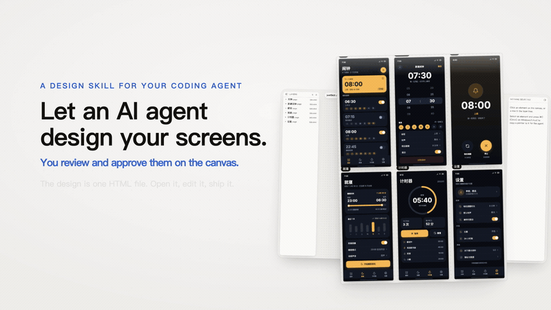
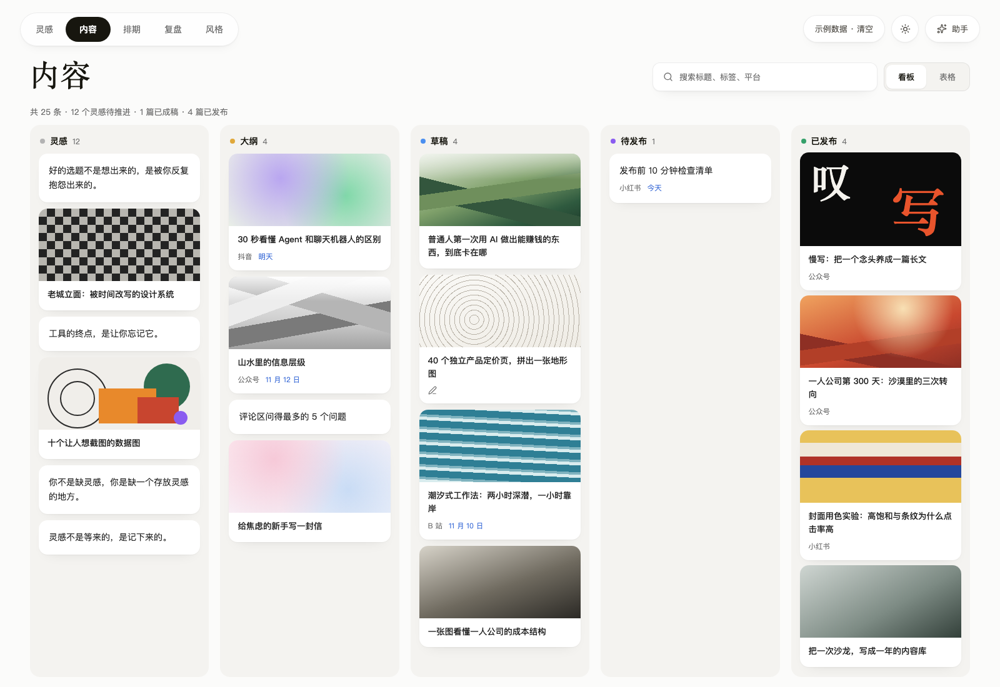
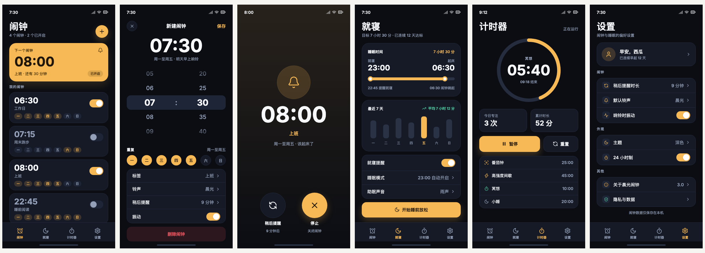
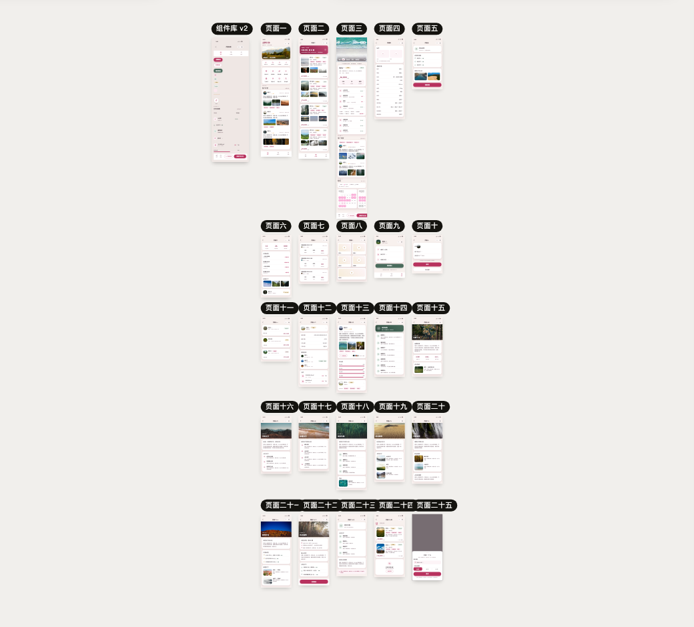
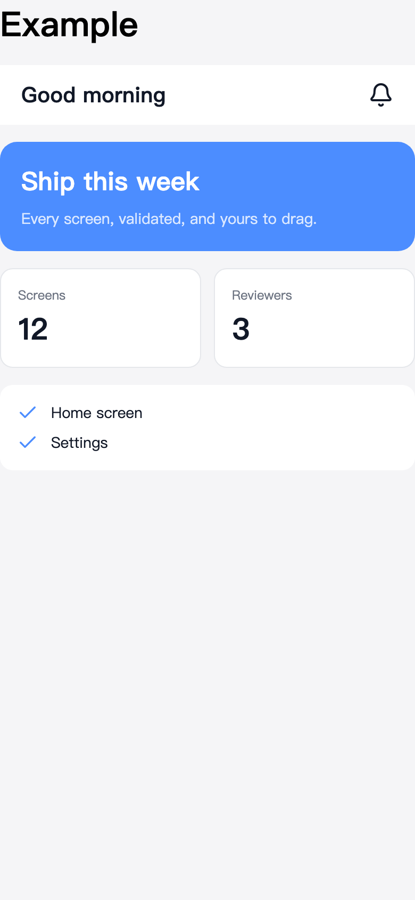

<div align="center">

# JustSkill Design

English · [简体中文](README.md)

[](https://github.com/justskill-ai/justskill-design/actions/workflows/test.yml)
[](LICENSE)

**Design, just a skill.**

**A new paradigm for design software.**

No MCP server. No app. No account. No cloud. Collaboration happens in git —
there is one Skill, and one HTML file.

**What it is.** A design tool that lives in your repository, not in a design app.
Your agent runs the skill, designs the screens, and leaves one HTML file behind.
You review those screens on a local canvas, approve them, and the validated file
becomes the spec the code is written against. You never draw — the agent draws,
you judge.

</div>

**How to use it.**

**1. Hand it to your agent.**
```text
Run `npx skills use "https://github.com/justskill-ai/justskill-design" --skill "justskill-design"` and follow the printed instructions.
```

**2. Say what you want.** A new product:
```text
I want to build a note-taking app: it records the small things from each day that are worth remembering, and how I felt at the time. A calendar shows my mood as a weather chart.
```

An existing app whose UI still looks AI-generated:
```text
Read the current program, its product design and its philosophy. Put together a design style that belongs to this product, then use the justskill-design skill to produce a design file. Once I approve the screens, refactor the UI to match.
```

**3. Review and approve.** The agent opens the canvas as it designs. Select an
element, press ⌘C, paste the copied pointer into the agent chat, and say what to
change; the agent applies one operation per change. When the screens are right,
approve them, and it implements them in your stack.



[Watch the full 30-second demo (MP4)](docs/justskill-demo.mp4)

## What lives in your repo

Two things are versioned: the tool and the design.

| In your repository | What it is | Why that matters |
|---|---|---|
| **The Skill** | the design canvas | it versions with your code; the agent opens it when needed, and nothing is installed or left running |
| **The HTML** | the design artifact | it opens without this tool, diffs as text, and can be sent anywhere |

The design is not a document trapped inside an app. It is a valid, self-contained
HTML file: open it in any browser and the screens are there. That is what makes
it a file you can `git diff`, review in a pull request, and hand to someone
offline — no renderer, no account, no export step.

## A new software paradigm

This is not a faster way to draw in a design app. It is a different shape of
design software.

**AI-native.** The agent does the designing. You do not open a canvas until there
is something to review, and you never drag a rectangle to express an idea.

**Agent-driven, human-approved.** The machine does the work; you keep the
judgment. Approve a screen, point at an element, send it back — the agent applies
the change as one operation and shows the receipt.

**Software as a skill.** The tool is a directory the agent reads, opened on
demand and put down when the work is done — 随用随开. No install, no account, no
cloud copy, no version of the tool drifting away from the design it produced.

**Evolvable.** The tool is source, not a binary. An agent can read the CLI, the
format and the canvas, then change them for this project — something no app can
offer. One base, endless variants: that is the new meaning of AI-native here.

**The design is an artifact, not a session.** It lives in your repository, next
to the code, and the validated file is the spec that code is reviewed against.

**Open source by nature.** The tool is a directory, the artifact is a file, and
there is nothing to rent — no seat, no cloud, no format to lock. So it is MIT,
free, and fully open source. Giving the tool away is not a sacrifice: it is how
the artifact comes to belong to everyone.

I wrote the longer argument — what design software becomes when it stops being an
app — in [Design software after the app](docs/paradigm.md).

### How it compares with other design tools

The question is not which tool has more features. It is where the design lives,
who can edit it, and whether the machine that wrote it can be told it is wrong.

| | JustSkill Design | Figma · Penpot · Sketch | Pencil (pen.dev) | AI app builders (v0, Lovable, Bolt) | Agent writing HTML/CSS by hand |
|---|---|---|---|---|---|
| **The design is** | one self-contained HTML file with inline styles and `data-id` on every element | a document in that tool's format, inside that tool (app or cloud) | a `.pen` file — an open JSON schema agents can read, drawn in its app | a running app; the design is a side effect of the code | the same kind of HTML file, with no structure the tool understands |
| **How the agent works on it** | reads and writes the file itself, through the CLI or the canvas | through a plugin, Dev Mode/MCP server, or screenshots of the canvas | an on-canvas agent, MCP, or the CLI; it is agent-first by design | prompt in, code out; the design is regenerated rather than edited | writes the file directly |
| **Can it be refused before you look?** | yes — closed property set, canonical form, diagnostics that name the fix | no; the design language accepts what the canvas accepts | the schema is open and there is a CLI, but the format is not built around refusing a bad declaration; you still find out on the canvas | usually no; the browser is the first check | no |
| **Lives in git, diffs like code** | yes, one file, readable diffs | not as a file you commit; visual history only | the `.pen` file commits, but the diff is a design document's JSON, not a page's markup | code yes, design intent no | yes, usually noisy |
| **How a human reviews it** | local canvas: layer tree, inspector, zoom, page names | the app itself, with comments and live multiplayer | the app: canvas, layers, components, effects, share link | browse the built app | open the file in a browser |
| **Setup** | a skill directory; no account, no server, no install | account + app, often an MCP server for agent access | app + account, then MCP or CLI for agents | account + cloud project | nothing |
| **Evolvable** | yes — the tool is source in your repo: an agent can read it and change the CLI, the format or the canvas for this project | plugins and APIs around a closed core; the app itself is not yours to change | the `.pen` schema is open, but the editor is not in your repo; you extend it through MCP and the CLI, not by forking it | you get the generated app, not the builder; the tool is not yours | fully yours, but there is no tool to evolve — you would be writing one |

[Pencil](https://www.pen.dev) is the nearest neighbour: it also treats the file as the
interface and lets agents write the document. The difference is where the
artifact lands — its `.pen` file is a design document for its app, while this
project's artifact is an HTML file that opens anywhere. The two meet in the
middle: `node design.mjs import pen` turns a `.pen` file into this format, which
is how the 26-artboard example was made.

Where this is the wrong tool:

- You want components, variants, prototyping, shaders or live multiplayer review.
  Figma, Penpot and Pencil are better at being a design tool.
- You want a running app without a design step. An AI app builder is the right
  shape.
- The screen needs the full CSS toolbox — motion, effects, a component system,
  responsive breakpoints — rather than a set of app screens. The scope is
  deliberate; see `docs/how-it-works.md#scope`.
- You do not work with an AI agent. This is a skill for an agent, not a
  standalone editor.

## What it can design

Four design files in `examples/`, one format, and no image files in the
repository: every picture is a gradient, an inline SVG, or a URL from the
checked photo catalogue.

| | |
|---|---|
| <br><br>**A desktop product.** Six pages — an inspiration board, a five-column content board, a calendar, an analytics screen, and a style library. Tilted cards, a dot grid, glass toolbars, an area chart drawn as one SVG. [`examples/dsh-media-desk.html`](examples/dsh-media-desk.html) | <br><br>**A six-screen app.** The alarm list, the editor with a wheel picker, the ringing screen, bedtime, the timer, settings. Hand-written page by page through `add` and `set`, with the canvas open. [`examples/alarm.html`](examples/alarm.html) |
| <br><br>**A 26-artboard import.** A real 705 KB `.pen` file: 26 artboards, 239 references inlined, 140 overrides applied, one named loss. [`examples/miniprogram.html`](examples/miniprogram.html) | <br><br>**The smallest design.** One page, 22 elements: the shortest file that is still a real, valid, exportable design. [`examples/design.html`](examples/design.html) |

Open one the way a person looks at a design:

```sh
node design.mjs serve examples/alarm.html
```

## Get started

The one-liner at the top works for the current session. To install it once for
every session:

```sh
npx skills add "https://github.com/justskill-ai/justskill-design" --skill "justskill-design" -g -y
```

That copies the skill into `~/.agents/skills/justskill-design` and links it into
the agent directories the CLI manages; `npx skills update` keeps it current. The
skill needs about 1 MB (`SKILL.md`, `references/`, `design.mjs`, `lib/`,
`canvas/`); the demo video and screenshots are for people, and a copied install
can drop them to free about 5 MB — the agent will offer to.

## Technical details

The README stops here on purpose. The format, the commands, the canvas, the
write path and the test numbers are documented where they belong:

| Document | What it answers |
|---|---|
| `SKILL.md` | What the agent reads on every trigger: when to use this, the format, the refusals, the writing rules. |
| `docs/paradigm.md` | The longer argument: software as a skill, design software after the app, evolvability, and the nine-stage loop. |
| `docs/how-it-works.md` | Why the design file is HTML, the format in one screen, every command, the canvas, the write funnel, the receipt, the scope, what runs at run time, and installing from the checkout. |
| `docs/quality.md` | What the test suite pins, and the measurements taken today. |
| `docs/format-v3.md` | The frozen contract: element model, canonical form, diagnostic codes, module boundaries. |
| `references/styling.md` | Every allowed property and its value grammar. |
| `references/schema.md` | The element contract, generated from the format table. |
| `references/images.md` | The verified photo catalogue. |
| `references/product-flow.md` | The software-development playbook, stage by stage: from idea to code. |

The three product documents have Chinese editions in [`docs/zh/`](docs/zh/README.md);
`docs/format-v3.md` and the generated `references/` stay English on purpose.

## Credits

`examples/dsh-media-desk.html` recreates the interface of
[dsh-media-desk](https://github.com/woniuniuniu/dsh-media-desk), a DeepSeek
Harness plugin for media workflows.

`test/fixtures/real/open-design-components.html` is a copy of a fixture from
[OpenDesign](https://github.com/nexu-io/open-design) (Apache-2.0), kept as a
real-world parse case.

The photographs in `references/images.md` and `examples/miniprogram.pen` come
from [Unsplash](https://unsplash.com) and are used under the
[Unsplash License](https://unsplash.com/license).

## License

MIT — see [LICENSE](LICENSE). The OpenDesign fixture and the Unsplash
photographs are third-party material under their own licenses, credited above.
