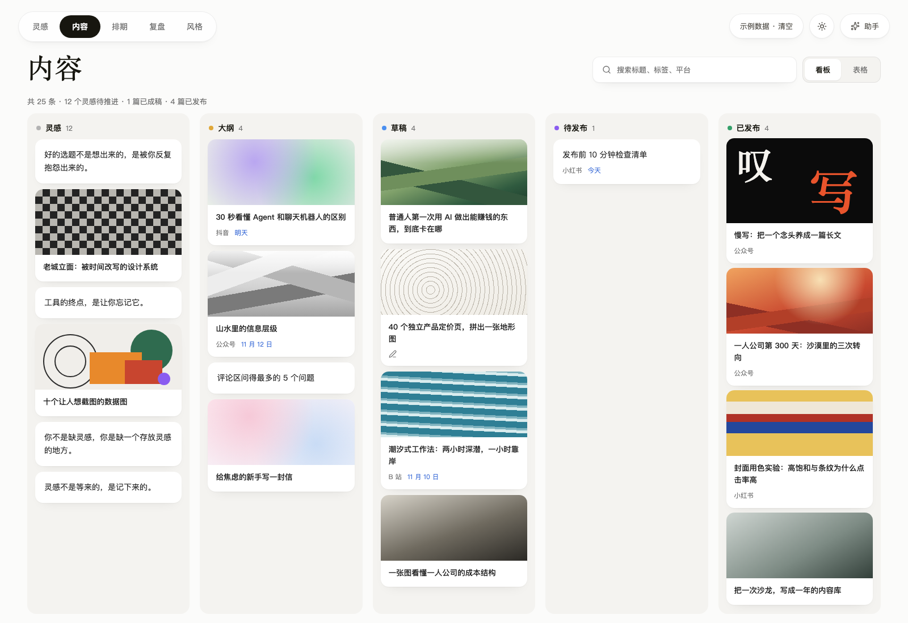
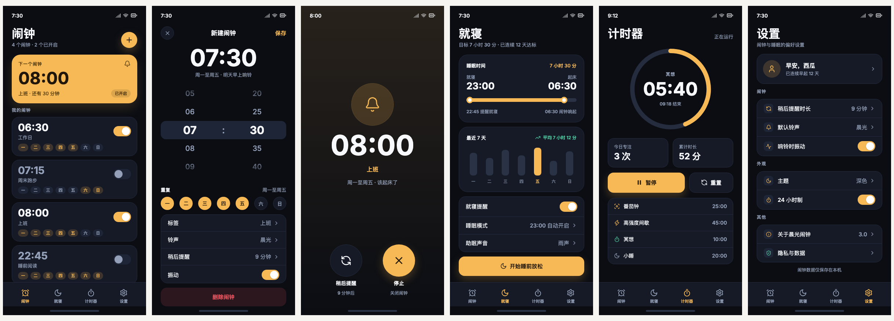
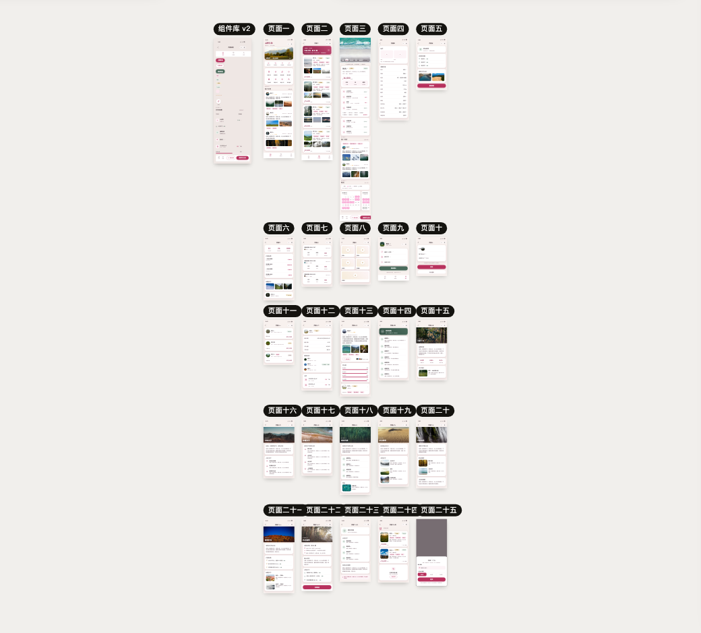
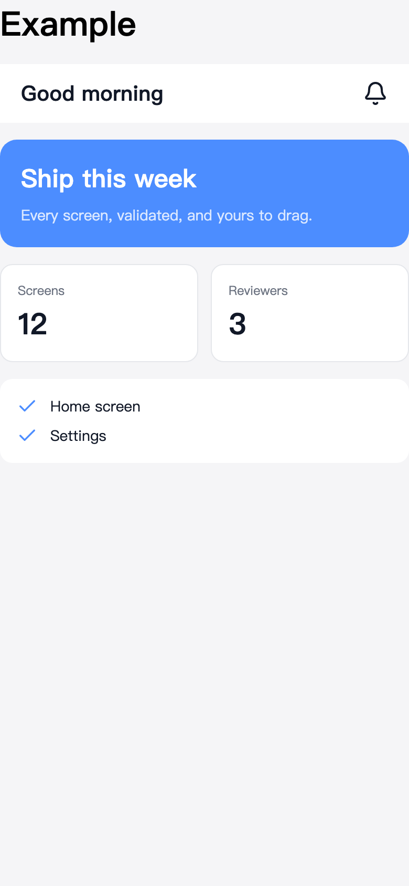
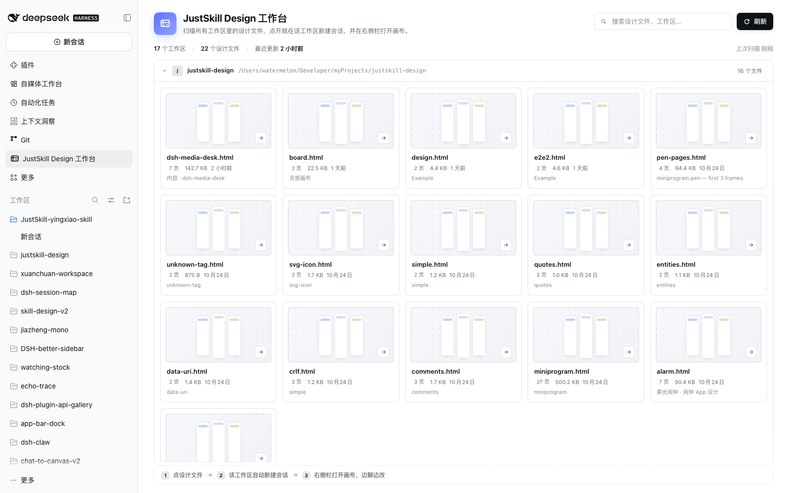

<div align="center">

# JustSkill Design

[English](README.en.md) · 简体中文

[](https://github.com/justskill-ai/justskill-design/actions/workflows/test.yml)
[](LICENSE)

**Design, just a skill.**

**设计软件新范式。**

没有 MCP，没有 APP，没有账号，没有云端。协作发生在 git 里——只有一个 Skill 和一张 HTML。

**它是什么。** 一个活在代码仓库里、而不是活在设计软件里的设计工具。你的 agent 运行这个 skill，设计页面，最后留下一张 HTML 文件；你在本地画布上评审、确认，校验通过的文件就是写代码时的规格。<br>
你不画图——agent 画，你判断。

</div>

**怎么用。**

**1. 把它交给你的 agent。**
```text
Run `npx skills use "https://github.com/justskill-ai/justskill-design" --skill "justskill-design"` and follow the printed instructions.
```

**2. 说你要什么。** 做一个新产品：
```text
我想做一个笔记 App：记录我每天值得被记住的事情，以及当时的心情。可以有个日历展示我的心情晴雨表。
```

改一个已有产品，去掉 UI 的“AI 味”：
```text
读取一下当前程序的产品设计、理念，帮我整理一份属于这个程序的设计风格，并使用 justskill-design 出一份设计稿。等我确认设计稿效果后，按照设计重构 UI。
```

**3. 评审、确认。** agent 一边设计一边打开画布。选中一个元素，按 ⌘C，把复制出来的指针粘贴回对话，说要改什么；agent 一次只应用一个操作。页面都对了就确认，它会在你的技术栈里把设计实现成代码。


[看完整的 30 秒演示（MP4）](docs/justskill-demo-zh.mp4)

## 你的仓库里有什么

被版本化的有两样：工具和设计。

| 在你的仓库里 | 它是什么 | 为什么重要 |
|---|---|---|
| **Skill** | 设计画布 | 它和你的代码一起版本化；agent 需要时打开它，没有东西被安装、也没有进程常驻 |
| **HTML** | 设计产物 | 它不依赖这个工具就能打开、能当文本 diff、能发给任何人 |

设计不是被关在某个 app 里的文档，而是一张合法、自包含的 HTML 文件：用任何浏览器打开，页面就在那里。所以它能被 `git diff`、能在 pull request 里评审、能离线交给别人——不需要渲染器，不需要账号，也不需要“导出”这一步。

## 一种软件新范式

它不是“更快的设计 app”，而是另一种形状的设计软件。

**AI 原生。** 设计由 agent 完成。没有东西可评审之前，你根本不用打开画布；你也不用拖一个矩形来表达想法。

**Agent 驱动，人来审批。** 机器干活，判断留给人。通过一页、指一个元素、退回去改——agent 把改动作为一个操作应用，并给你看回执。

**软件 Skill 化。** 工具是 agent 读取的一个目录，需要时打开、做完就放下——随用随开。没有安装、没有账号、没有云端副本，也不存在“工具的版本和它产出的设计对不上”。

**可进化。** 工具是源码，不是二进制。agent 能读 CLI、读格式、读画布，再按这个项目的需要去改它们——这是 app 给不了的。同一个基座，长出无穷的变化：这才是这里「AI 原生」的新含义。

**设计是产物，不是一次会话。** 它就在你的仓库里、挨着代码；校验通过的那份文件，就是评审代码时对照的规格。

**它天生开源。** 工具是目录、产物是文件，就没有东西可以出租——没有席位、没有云端、没有锁得住的格式。所以它 MIT、不收费、全开源。让利不是牺牲：工具交出去，产物才真正属于每个人。

更长的论证——当设计软件不再是一个 app，它变成了什么——写在[《App 之后的设计软件》](docs/zh/paradigm.md)里（[英文原文](docs/paradigm.md)）。

### 和其他设计软件比

真正的问题不是“谁的功能更多”，而是：设计活在哪里、谁能改它、写下它的那台机器能不能被明确告知“这里写错了”。

| | JustSkill Design | Figma · Penpot · Sketch | Pencil（pen.dev） | AI 应用生成器（v0、Lovable、Bolt） | Agent 直接手写 HTML/CSS |
|---|---|---|---|---|---|
| **设计是什么** | 一张自包含的 HTML 文件，内联样式，每个元素都有 `data-id` | 该工具格式的文档，活在该工具里（app 或云端） | 一个 `.pen` 文件——开放的 JSON schema，agent 能直接读写，但要在它的 app 里画 | 一个能跑的应用；设计是代码的副产品 | 同样是 HTML 文件，但没有工具能理解的结构 |
| **agent 怎么改它** | 直接读写文件，走 CLI 或画布 | 走插件、Dev Mode/MCP server，或者对着画布截图 | 画布内 agent、MCP 或 CLI；它从设计上就是 agent-first | 提示词进、代码出；设计是被重新生成，而不是被编辑 | 直接写文件 |
| **你查看之前能否被拒绝** | 能——封闭的属性集合、规范形式、指出修复方式的诊断 | 不能；设计语言接受画布接受的写法 | schema 开放、也有 CLI，但格式本身不围绕「拒绝一条坏声明」设计；对错仍然在画布上见 | 通常不能；浏览器是第一个检查 | 不能 |
| **进 git、像代码一样 diff** | 能，一个文件，diff 可读 | 不能作为你提交的文件；只有可视化历史 | `.pen` 文件可以提交，但 diff 是一份设计文档的 JSON，不是一页页面的标记 | 代码可以，设计意图不行 | 可以，但通常很吵 |
| **人怎么评审** | 本地画布：图层树、检查器、缩放、页名 | 工具本身，配评论和实时协作 | 在它的 app 里：画布、图层、组件、特效、分享链接 | 浏览构建出来的应用 | 浏览器打开文件 |
| **安装成本** | 一个 skill 目录；无账号、无 server、无安装 | 账号 + app，agent 接进来往往还要 MCP server | app + 账号，agent 再走 MCP 或 CLI | 账号 + 云项目 | 无 |
| **可进化性** | 能——工具就是你仓库里的源码：agent 能读它，按这个项目改 CLI、改格式、改画布 | 插件和 API 围着一个封闭内核；app 本身不是你能改的 | `.pen` schema 开放，但编辑器源码不在你仓库里；扩展靠 MCP 和 CLI，不是靠 fork 编辑器 | 拿到的是生成出来的应用，不是生成器；工具不属于你 | 完全属于你，但这里没有工具可以进化——你得自己写一个 |

[Pencil](https://www.pen.dev)（pen.dev）是这里最接近的邻居：它同样把文件当接口，也允许 agent 直接写文档。区别在产物落在哪里——它的 `.pen` 是交给它的 app 的设计文档，而这个项目的产物是一张在任何地方都能打开的 HTML。两者在中间接上：`node design.mjs import pen` 把 `.pen` 转成这个格式，26 画板的那个案例就是这么来的。

这些情况下它不是对的工具：

- 你要组件、变体、原型、shader 或实时多人评审——Figma、Penpot 和 Pencil 更擅长做设计工具。
- 你要跳过设计步骤、直接拿到能跑的应用——AI 应用生成器才是对的形状。
- 这个页面需要完整的 CSS 工具箱——动效、特效、组件系统、响应式断点——而不是一组 App 页面。范围是故意收窄的，见 `docs/zh/how-it-works.md#范围`。
- 你不和 AI agent 一起工作。这是给 agent 的 skill，不是独立编辑器。

## 能设计到什么程度

`examples/` 里四个设计文件，同一个格式，仓库里没有任何图片文件：画面要么是渐变、要么是内联 SVG，要么是经过校验的图片清单里的 URL。

| | |
|---|---|
| <br><br>**一个桌面产品。** 六页——灵感板、五列内容看板、日历、数据复盘页、风格库。倾斜卡片、点阵画布、毛玻璃工具条、一整张 SVG 面积图。[`examples/dsh-media-desk.html`](examples/dsh-media-desk.html) | <br><br>**一个六屏 App。** 闹钟列表、带滚轮选择器的编辑器、响铃页、就寝、计时器、设置。用 `add` 和 `set` 一页页手写，画布一直开着。[`examples/alarm.html`](examples/alarm.html) |
| <br><br>**一次 26 个画板的导入。** 一个真实的 705 KB `.pen` 文件：26 个画板，239 个引用被内联，140 个覆盖被应用，一处被明确记录的丢失。[`examples/miniprogram.html`](examples/miniprogram.html) | <br><br>**最小的设计。** 一页、22 个元素：还称得上是真实、合法、可导出设计的最短文件。[`examples/design.html`](examples/design.html) |

像一个人看设计那样打开它：

```sh
node design.mjs serve examples/alarm.html
```

## 开始用

最上面那行提示词在当前会话里就能用。要在每个会话里都有，装一次：

```sh
npx skills add "https://github.com/justskill-ai/justskill-design" --skill "justskill-design" -g -y
```

它会把 skill 复制到 `~/.agents/skills/justskill-design`，再链接进 CLI 管理的
agent 目录；`npx skills update` 负责更新。skill 本身只要约 1 MB（`SKILL.md`、
`references/`、`design.mjs`、`lib/`、`canvas/`）；演示视频和截图是给人看的，复制安装
的话可以删掉腾出约 10 MB——agent 会主动提出。

## 在 DeepSeek Harness 里用

这个仓库同时是一个 DSH（DeepSeek Harness）插件。装上以后：

- **skill 自动注册**进 DSH，不用再软链到 `~/.agents/skills`
- 左侧栏多一个 **JustSkill**：打开「JustSkill Design 工作台」，按工作区列出所有设计文件
- 点一个设计文件：在它所属的工作区**新建会话**，自动切换到该会话，并在**右侧栏**打开 Canvas tab；聊天在左、画布在右，agent 的修改实时刷新
- Agent 要打开画布时会调用 `justskill_canvas` 工具，在右侧栏打开/聚焦 Canvas tab；DSH 下不会再跑 `serve` 或弹浏览器
- 右栏 Canvas tab 没有指定文件时，会列出**当前工作区**的设计文件，点一个就在该 tab 内打开

推荐从 npm 安装：

```sh
dsh plugin --profile web add justskill-design
```

> 如果 pnpm 启用了 `minimumReleaseAge`（新版默认会对刚发布的版本等待 24 小时），包管理器可能暂时解析到旧版本；这时固定版本：
>
> ```sh
> dsh plugin --profile web add justskill-design@3.2.0
> ```

也可以直接从 GitHub 安装（不需要 npm）：

```sh
dsh plugin --profile web add github:justskill-ai/justskill-design
```

本地开发用 checkout：

```sh
dsh plugin --profile web add link:"/path/to/justskill-design"
```

然后在 DSH 的 Plugins 页启用并重启。Desktop 用同一个包，在桌面端的插件页安装即可；
不想装插件也可以继续用上面的 `npx skills add`——skill 和插件是同一份代码。



## 技术细节

README 到这里就停了，是有意的。格式、命令、画布、写入路径和测试数据，都写在它们该在的地方：

| 文档 | 回答什么 |
|---|---|
| `SKILL.md` | agent 每次被触发时读的内容：什么时候用、格式、拒绝规则、写作规则。 |
| `docs/zh/paradigm.md` | 更长的论证：软件 Skill 化、app 之后的设计软件、可进化性，以及九阶段循环。 |
| `docs/zh/how-it-works.md` | 为什么设计文件是 HTML、一屏看懂格式、所有命令、画布、写入漏斗、回执、范围，运行时到底需要什么，以及从 checkout 安装。 |
| `docs/zh/quality.md` | 测试套件固定了哪些不变量，以及今天量到的数据。 |
| `docs/format-v3.md` | 冻结的契约：元素模型、规范形式、诊断码、模块边界。 |
| `references/styling.md` | 每个允许的属性及其取值语法。 |
| `references/schema.md` | 元素契约，由格式表生成。 |
| `references/images.md` | 经过校验的图片清单。 |
| `references/product-flow.md` | 软件开发的分阶段剧本：从想法到代码。 |

`docs/format-v3.md` 和 `references/*.md` 保持英文（冻结的契约、生成的文件）；其余中文文档见 [docs/zh/](docs/zh/README.md)。

## 致谢

`examples/dsh-media-desk.html` 复刻的是
[dsh-media-desk](https://github.com/woniuniuniu/dsh-media-desk) 的界面——一个
DeepSeek Harness 的自媒体工作台插件。

`test/fixtures/real/open-design-components.html` 是 [OpenDesign](https://github.com/nexu-io/open-design)（Apache-2.0）里一个 fixture 的副本，保留作为真实世界的解析用例。

`references/images.md` 里的照片和 `examples/miniprogram.pen` 来自 [Unsplash](https://unsplash.com)，按 [Unsplash License](https://unsplash.com/license) 使用。

## 许可证

MIT——见 [LICENSE](LICENSE)。OpenDesign 的 fixture 和 Unsplash 的照片是第三方材料，遵循它们自己的许可证，已在上文注明。
