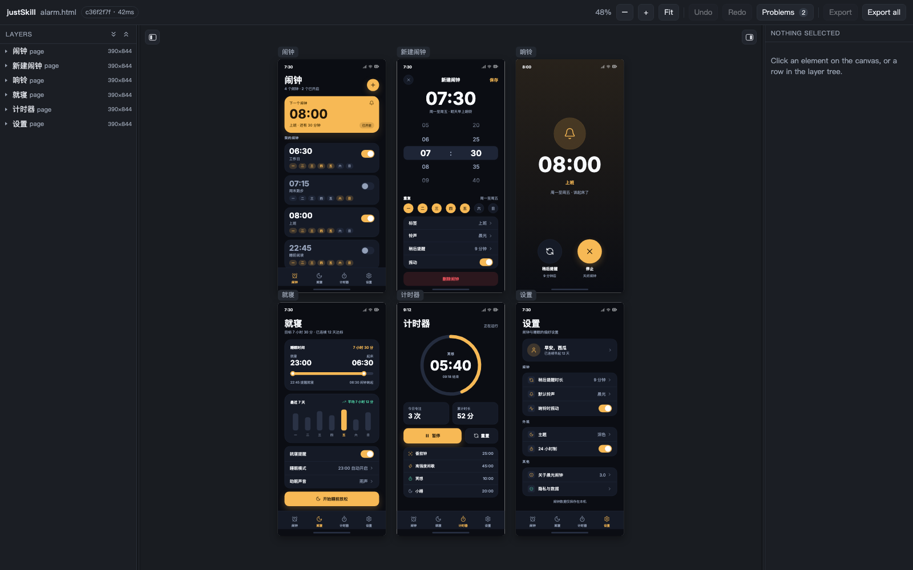
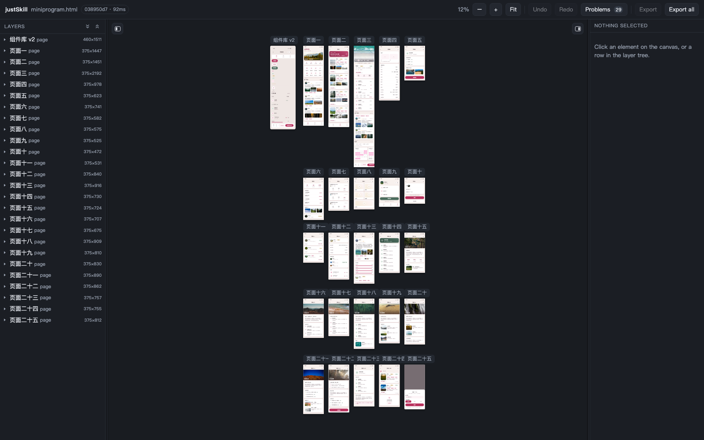

# JustSkill Design

[English](README.md) · [简体中文](README.zh-CN.md)

[](https://github.com/justskill-ai/justskill-design/actions/workflows/test.yml)
[](LICENSE)

## 一个做网页和 App 界面的设计工具

由你的 coding agent 驱动——可以理解成 Pen 或 Figma，区别在于设计就是一个经过校验的 HTML 文件：打开就能看，改完就能交付。

> **Design, just a skill.**
>
> **没有 MCP server，没有要安装的 app，没有账号，没有构建步骤，没有 `npm install`。**
>
> skill 就是 agent 读取的一个目录，所以唯一的“安装”就是把它交给 agent。
>
> `HTML-native` `Validated` `Agent-friendly`


[看完整的 24 秒演示（MP4）](docs/justskill-demo.mp4)

**立即使用。** 把下面这段复制给你的 agent：

```text
Run `npx skills use "https://github.com/justskill-ai/justskill-design" --skill "justskill-design"` and follow the generated skill instructions now.
Read its complete output, redirecting it to a temporary file first if necessary.
Resolve relative paths from the supporting-files directory it provides.
```



## 是 skill，不是产品

产品要你安装它、升级它、登录它。skill 是 agent 读取的一个目录，而这里这个目录就是全部工具：指令、CLI，以及 CLI 校验的格式。

| 没有 | 意味着什么 |
|---|---|
| 没有 MCP server | 没有要启动的进程，没有要改的客户端配置，模型和文件之间也没有协议。模型跑的是 `node design.mjs`——和你会敲的是同一条命令——而且每次修改都走同一个写入漏斗。 |
| 没有要安装的 app | 没有要下载、更新或常驻的应用。skill 就是这个仓库，被链接进你的 skills 目录；画布是 CLI 按需在本地起的页面，用完就关。 |
| 没有账号 | 不用登录、没有套餐、没有云端副本、没有使用量上报。设计文件就是唯一的状态，它就在你的 checkout 里。 |
| 没有构建步骤 | 源码就是运行物——没有打包器、没有转译器、没有会落后于源码的构建产物。改 checkout，装好的 skill 跟着变。 |
| 没有 `npm install` | 没有依赖，也没有 lockfile：没有东西要安装、审计或升级。Node 18 或更高版本，只用内置模块。 |

每少一样东西，就少一种“设计还没出现就先失败”的方式——进程没起来、会话过期、依赖解析成了别的东西、构建产物比源码旧。剩下的，就是一张能打开、能 diff、能提交的 HTML 文件，以及一套不会静默出错的命令。

```
design.html  ──validate──▶  diagnostics       (what is wrong, and what to write instead)
     ▲          format   ──▶  canonical text    (one intent, one spelling)
     │          export   ──▶  a deliverable      (one page, or a whole site)
     │
     └──── canvas ◀── add / set / remove / move / rename
```

## 为什么设计文件是 HTML

模型本来就很会写 HTML 和 CSS。让它去写一套私有的 JSON 文档，等于把注意力花在一个还得先学的格式上；而且每个这样的文件都得先有渲染器，别人才看得到设计。

所以设计文件就是标记本身。它是一张合法、自包含的 HTML 文件：用浏览器打开，设计就在那里。这个工具加上的不是一种格式，而是四个保证：

| 保证 | 意味着什么 |
|---|---|
| 它会被检查 | 每个元素、每条声明，要么被接受，要么被报告。不会有东西被静默丢弃。 |
| 它可以被编辑 | 每个元素都有 `data-id`，所以一次编辑就是一个字节区间，而不是重写。 |
| 它是规范形式 | 同一个意图只有一种写法。diff 保持可读，往返保持精确。 |
| 它是诚实的 | 没人编辑过的文件，会一个字节不变地回来。你自己的格式、你的注释、你手写的 `<svg>`，都还留在你放的地方。 |

## 一屏看懂格式

```html
<!doctype html>
<html lang="en">
<head>
  <meta charset="utf-8">
  <title>Landing</title>
  <meta name="design-schema" content="3.0">
  <style>:root{ --color-ink:#111827; --space-md:16px }</style>
  <style>section[data-type="page"]{ margin:0 0 24px }</style>
</head>
<body>
  <section data-id="home" data-type="page" data-canvas="0,0" style="width:390px;height:844px">
    <div data-id="home__root" data-type="frame" style="display:flex;flex-direction:column;gap:16px;padding:24px">
      <p data-id="home__title" data-type="text" style="font-size:32px;font-weight:700;color:var(--color-ink)">你好</p>
    </div>
  </section>
</body>
</html>
```

`<head>` 里只允许两个 `<style>` 块，而且两个都会读取：token 块（`:root`）和页面框架块。除此之外，每个元素都带内联 `style`。每个元素都带 `data-id` 和 `data-type`。

- `docs/format-v3.md` —— 冻结的契约：元素模型、规范形式、诊断码、模块边界。
- `references/styling.md` —— 45 个允许的属性及其取值语法。
- `references/schema.md` —— 元素契约，由格式表生成。
- `references/images.md` —— 经过校验的 Unsplash 图片，用户没有提供图片时可以使用；每张都写明拍的是什么、谁拍的。

## 示例

`examples/` 下有 3 个文件。每个都能通过校验，每个都已经是规范形式，而且 `test/purity.test.mjs` 会读取这个目录，把每个 `examples/*.html` 都按这个标准检查——所以第四个文件一落地就会被检查。



| 文件 | 规模 | 回答了什么 |
|---|---|---|
| `examples/design.html` | 1 页，22 个元素 | 还称得上是设计的最小文件长什么样：一个 header、一个 hero、两张数据卡、一个列表、三个 lucide 图标、一个 token 块。 |
| `examples/alarm.html` | 6 页，447 个元素 | 手写的 App 长什么样：闹钟列表、带滚轮选择器的编辑器、响铃页、就寝、计时器、设置。它的颜色是 14 个 token，所以换主题只要一条 op——`node design.mjs tokens examples/alarm.html set color.accent '#7c3aed'`。它也是按这个 skill 要求的方式写出来的：用 `add` 一页页加，用 `set` 调间距，画布一直开着，没有整文件重写。 |
| `examples/miniprogram.html` | 26 页，2197 个元素 | `.pen` 文件会变成什么样：一个真实的 705 KB 文件，26 个画板，239 个引用被内联，其中 140 个带覆盖，还有一处被明确记录的丢失（`perCornerRadius`）。用 `node design.mjs import pen <the .pen> -o examples/miniprogram.html --title miniprogram` 重新生成；提交的副本一旦过期，`test/pen-reader.test.mjs` 就会失败。 |

像一个人看设计那样打开它。画布会写回同一个文件，所以一次拖拽和一条命令就是同一次编辑：

```sh
node design.mjs serve examples/alarm.html
```

## 命令

```sh
node design.mjs new      design.html --name home --title Landing
node design.mjs validate design.html --json
node design.mjs format   design.html --check
node design.mjs ls       design.html --pages
node design.mjs show     design.html home__title
node design.mjs add      design.html --html-file card.html --in home__root
node design.mjs set      design.html home__title --style 'font-size:40px'
node design.mjs move     design.html home__card --index 0
node design.mjs rename   design.html home__card product
node design.mjs migrate  design.html
node design.mjs remove   design.html home__note
node design.mjs export   design.html --all -o dist
node design.mjs import   pen some.pen -o design.html
node design.mjs serve    design.html
```

`serve` 会打印一个带 token 的 URL，并打开画布。画布和 CLI 走同一个写入漏斗，所以拖拽和 `set` 不可能互相矛盾。

画布分三列：左边是图层树——每一页和它下面嵌套的元素，默认收起，表头有全部展开和全部收起，在画布上点中一个元素会展开到它的路径；中间是设计本身；右边是选中元素自己的属性，按分区组织，用该属性的语法所要求的控件来编辑。悬停时会显示指针所在的容器（实线）和该容器的直接子元素（虚线）——点击选中的是指针下的虚线框，Escape 往回退一层。每一页左上角都有一个胶囊形状的页名，页名属于界面外壳而不是画面内容：它在任何缩放下都保持自己的字号和那几像素的留白，所以 10% 和 100% 看起来一样。任一侧都能用画布边缘的按钮或 `⌘\`（图层树）、`⇧⌘\`（检查器）折叠，边缘也可以拖动改宽度。这些都不是文档状态：面板只把状态记在浏览器里，从不往设计文件写一个字节。

退出码：`0` 成功，`1` 被拒绝或无效，`2` 文件不可读或参数错误。

### 写入漏斗

每一次写入都走同一条路径，无论来自命令还是画布：

1. 重新读取文件——可能有另一个写入者改过它
2. 先校验它，这样已有的错误不会被算到这次编辑头上
3. 把改动编译成 ops
4. 应用 ops
5. 再校验一次；除非这次编辑**没有引入任何新错误**，否则拒绝
6. 只规范化被改动的节点，然后原子写入
7. 打印回执

第 5 步让坏文件变得可修。文件可以本来就有错误；一次编辑可以修掉它们；但一次编辑不能再加上一个错误。

### 回执

模型看不到文件，所以回执就是它拥有的全部。每条声明要么被消费，要么被报告：

```
$ node design.mjs add design.html --html-file card.html --in home__root
added:      home__cta, home__cta-label  (2 elements)
normalized: #fff → #ffffff
normalized: 12px 12px 12px 12px → 12px
normalized: rgba(0,0,0,0.6) → #00000099
dropped:    cursor:pointer — The format describes appearance, not interaction. A cursor is behavior.
applied 1 op, revision a161db2c (0 errors, 0 warnings)
```

拒绝是一个结果，不是失败，而且它会告诉你该写什么：

```
REFUSED  display: grid is not a value of display.
  Accepted: flex | block | none
design.html was not changed.
```

## 测试

```sh
npm test                # node --test
npm run images:check    # 需要网络：确认图片清单里每个 URL 仍然可访问
```

这套测试固定了哪些不变量，按“一旦失败，最先坏掉”的顺序：

| 套件 | 不变量 |
|---|---|
| `byte-fidelity` | 解析再序列化返回同样的字节——手写文件、真实文件、注释、未知标签和 `<svg>` 几何都包括 |
| `table` | 一张表驱动校验、规范化和提示；每个属性都有取值语法 |
| `validate` | 每个元素要么合法，要么得到一条指出修复方式的诊断 |
| `normalize` | 规范化是幂等的，而且永远不会碰已经是规范形式的文件 |
| `ops`、`fragment` | 操作可逆；片段会被编译、检查，并以具名理由拒绝 |
| `cli` | 退出码 0/1/2 在成功和拒绝路径上都稳定 |
| `images` | 图片清单的每一行都是唯一、可复制的 URL，写明了拍的是什么、谁拍的 |

## 今天量到的数据

| 指标 | 门槛 | 实测 |
|---|---|---|
| 首次响应的可读性（20 个真实片段） | ≥ 80% | **20/20 = 100%** |
| 静默丢弃 | 0 | 0 |
| 序列化往返 | 字节精确 | 字节精确，11 个 fixture，包括一个 73 KB 的生成设计 |
| 规范化 | 幂等 | 幂等 |
| `.pen` 导入 | 0 错误、`unmapped` 为空 | **0 错误，`unmapped` 为空** |
| `.pen` 导入账本 | 每次损失都有名字 | 1541 个源节点里 1 处损失（`perCornerRadius`） |
| pen 自己的导出 | 同一张图 | 文本行盒和箭头的四个角都在 0.1px 以内，`viewBox` 和字体一致 |
| 测试 | — | 684 通过，0 失败 |

`.pen` 的验收用例是一个真实的 705 KB 文件，26 个画板、1541 个源节点。它导入成 2197 个元素，耗时约 100 ms：239 个引用被内联，其中 140 个带着字段级补丁，在导入过程中被应用。账本统计的是实际产出的元素，所以 26 个画板不在这个数字里，而副本在。结果能通过校验，而且已经是规范形式：`examples/miniprogram.html` 里有 2223 个 `data-id`（2197 个元素加 26 个页面）和总共 3066 个标签，其余是 `<svg>` 几何和不是设计节点的包装元素。文件里有一个节点带四个不同的圆角半径，这个格式没有对应的写法，账本会按名字把它记下来。

这次导入是对 pen 自己的导出来测量的，不是对自己。pen 附带的欢迎文档——一个 1000×1458 的画板、两行文本、一支旋转的箭头——从 pen.dev 导出为 HTML，再在这里导入，然后在同一个浏览器里测量两张渲染结果：文本的两个行盒误差在 0.05px 以内（224.00/551 对 224.05/550.91，101.39/796.20 对 101.42/796.16），字体是 pen 导出所链接的同一个 Noto Sans（`measureText` 599 对 598.9），箭头的四个绘制角落在 pen 的 `transform: rotate(45deg)` 所放位置的 0.1px 以内。正是这次测量，让读取器用字形自己的盒子来算 `viewBox`，把描边轮廓画成 stroke 而不是给 `<svg>` 加 `border`，把旋转烘进轮廓，把作者写的换行保留为 `white-space: pre-line`，并且请求 `Noto Sans` 而不是假设机器上正好有它。

可读性指标的意思是：第一次响应永远可用，无论它是接受片段，还是用一条带代码、带目标、带修复方式的诊断拒绝它。这 20 个片段是模型真的会写的：`display:grid`、`position:fixed`、`rgba()`、`#fff`、单边 `margin`、缺 `alt`、标签和 `data-type` 不匹配、重复 id、`font` 简写、手写 `<svg>`。

**其中 10 个被按名字拒绝。另外 10 个能编译，其中 9 个会报告它改写了或丢弃了什么**——`#fff` 变成 `#ffffff`、四值 `padding` 被折叠、`cursor` 或 `transform` 落进 `dropped`。还有一个本来就是干净的。崩溃、静默丢弃、或者拒绝时什么都没说，都会判定这个指标失败。它不声称 100% 的设计都会被接受；它声称没有哪次首次响应是死路。`evals/evals.json` 逐片段写明那次响应必须包含什么，`test/evals.test.mjs` 负责检查。

## 安装

上面的提示词只在当前会话里生效。要在每个会话里都有，可以让 skills CLI 装到它认识的所有 agent，或者自己把 checkout 链接进去。

### 用 skills CLI

```sh
npx skills add "https://github.com/justskill-ai/justskill-design" --skill "justskill-design" -g -y
```

它会把 skill 复制到 `~/.agents/skills/justskill-design`，再链接进 CLI 管理的 agent 目录；之后用 `npx skills update` 更新。

### 用一个 symlink

```sh
git clone https://github.com/justskill-ai/justskill-design.git ~/Developer/justskill-design
node ~/Developer/justskill-design/scripts/install.mjs
```

仓库就是 skill，所以这次安装就是一条 symlink，指向 agent 本来就会读取的 skills 目录：没有编译，也没有东西常驻。它把 checkout 链接到 `~/.agents/skills/justskill-design` 和 `~/.claude/skills/justskill-design`，所以任何读取这些目录的 agent（包括 Claude Code）都能拿到它。链接是 symlink：改 checkout，装好的 skill 跟着变。`--uninstall` 删除两条链接，`--dry-run` 打印它准备做什么。

## 范围

这不是一个通用的 HTML 和 CSS 工具。它支持一个封闭集合：flexbox 布局、绝对定位、固定的属性白名单、图片、内联 SVG 图标，以及每个文本元素一段文字。没有 grid，没有 `position:fixed`，没有 transforms，没有动画，没有响应式断点，没有富文本。原因在 `docs/plan.md`，每个允许属性的取值语法在 `references/styling.md`。

## 致谢

`test/fixtures/real/open-design-components.html` 是 [OpenDesign](https://github.com/nexu-io/open-design)（Apache-2.0）里一个 fixture 的副本，保留作为真实世界的解析用例。

`references/images.md` 里的照片和 `examples/miniprogram.pen` 来自 [Unsplash](https://unsplash.com)，按 [Unsplash License](https://unsplash.com/license) 使用。

## 许可证

MIT——见 [LICENSE](LICENSE)。OpenDesign 的 fixture 和 Unsplash 的照片是第三方材料，遵循它们自己的许可证，已在上文注明。
